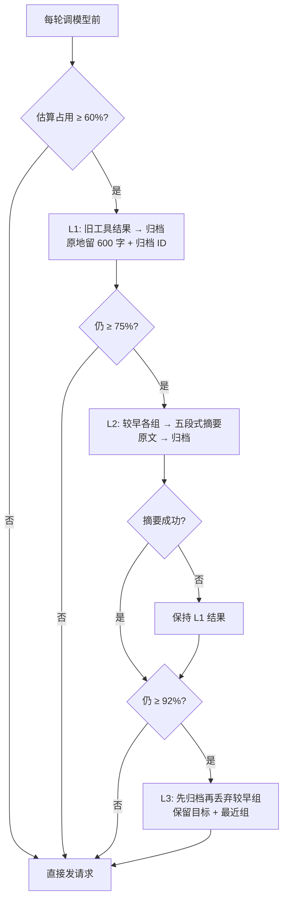

# agent-compaction

> 给「多轮工具调用」的 Agent 做上下文压缩：**压多少、压什么、丢了怎么找回来**，做成有测试、有指标、有评测的四级策略。

零运行时依赖，只用 Node 标准库。

---

## 一、这个项目要解决什么问题

Agent 跑到几十上百轮工具调用之后，上下文会被工具返回撑满。此时只有两种朴素选择：

- **直接截断** → 任务目标、早期关键事实一起没了，Agent 开始原地打转
- **不截断** → API 直接返回 `context_length_exceeded`，整个任务当场失败

这两种都会让一个已经跑了一半的任务白费。真实业务里，一个任务可能要查十几个接口、读几十个文件，跑十几分钟——**因为上下文溢出而重来一次，损失的是时间、token 和用户的耐心。**

本项目把「什么时候压、压哪一级、丢了的信息怎么找回」拆成**可验证的四级策略**，并用测试和评测把这些行为钉死。

---

## 二、能重点学到什么

| 能力 | 具体落点 |
|---|---|
| **上下文工程** | token 预算怎么算、压什么先压、摘要怎么写才不把目标带偏 |
| **无损优先的分级策略** | L1 可召回 → L2 有损摘要 → L3 兜底截断，为什么必须是这个顺序 |
| **Agent 循环的真实约束** | `tool_use` 和 `tool_result` 必须成对、角色必须交替，拆开就是 400 |
| **估算与校准** | 为什么估算永远不准（工具定义、网关注入、tokenizer 差异），以及怎么用真实 `usage` 校准 |
| **可验证性** | 判定式评测、变异测试（验证测试本身能不能抓到回归） |
| **生产化** | 无状态服务、健康检查、Prometheus 指标、容器化、优雅退出 |

---

## 三、能应对什么样的提问

面试里被问到这些，可以直接拿本项目的实现和数字回答：

**「你的 Agent 上下文溢出了怎么办？」**
> 四级压缩：L0 在工具结果进上下文前截断；L1 把较早的长工具结果移进归档，原地留摘要 + 归档 ID（无损）；L2 把较早的整段交互压成结构化摘要（有损，原文进归档）；L3 兜底，只留目标 + 最近几组，被丢的内容先归档再丢。触发线分别是窗口的 60% / 75% / 92%。

**「你为什么不用向量检索做归档召回？」**
> 规模不够。当前是关键词计数，归档几千条以内够用。接口收成 `put`/`recall` 两个方法，换 pgvector 时压缩逻辑一行不用改。

**「压缩会不会把任务目标压丢？」**
> 不会。有三条不变量，测试逐条覆盖：第一条用户消息永久保留；`tool_use` 和 `tool_result` 永远同进同出；角色必须交替。另外摘要必须包含「目标 / 已完成 / 待办 / 关键事实 / 失败的尝试」五段，格式不合格就重试，还不行就降级到 L3——宁可丢细节，也不让摘要把目标带偏。

**「你怎么知道压缩之后还有效？」**
> 三个场景、两种配置（压缩 / 不压缩）对比跑：短任务不该触发压缩；中等任务触发 L1/L2 后峰值从 33k 降到 8.5k；长任务不压缩会到 216k（真实 API 早就 400），压缩后稳定在 7.4k，且早期事实仍能按关键词召回。判定是二值的，可以直接挂 CI。

**「估算 token 不准怎么办？」**
> 不准是必然的——工具定义、网关注入的 system、tokenizer 差异都算不到。做法是用每次响应里的 `usage.input_tokens` 反推「固定差额」，用指数移动平均维护，下一轮把差额加回估算。用差额而不是比率，是因为工具定义这类开销每轮恒定，用比率会把短消息时的开销占比误判成整体膨胀。

**「压缩会不会引入安全问题？」**
> 进摘要和进归档之前都强制过一遍脱敏（key / token / 密码 / JWT），所以凭据不会被发给摘要模型，也不会落在归档文件里。

---

## 四、核心原理

### 4.1 为什么是四级而不是一级

压缩的本质是**用信息损失换窗口空间**。不同手段的代价差一个数量级：

| 级别 | 手段 | 代价 | 什么时候用 |
|---|---|---|---|
| L0 | 工具结果入场截断 | 无（可召回） | 单条结果超长，永远生效 |
| L1 | 旧工具结果移进归档 | 无（可召回） | 刚超过 60% |
| L2 | 整段交互压成摘要 | 一次额外模型调用 + 有损 | 超过 75% |
| L3 | 只留目标 + 最近几组 | 有损、丢上下文 | 超过 92% 或摘要失败 |

**关键判断：先做便宜且无损的，只有压不动了才付摘要的代价。** 多数实现在一开始就上「用 LLM 总结整段对话」，每轮多一次模型调用，成本高且不可逆。

### 4.2 分组：不可拆分的单位

`tool_use` 和紧随其后的 `tool_result` 必须当成一组。压缩只按组处理，不按单条消息处理——否则会把一次工具调用和它的结果拆开，API 直接 400。



### 4.3 摘要为什么要固定格式

自由文本摘要会漂移：这一轮说「在查订单」，下一轮变成「在查物流」，第三轮目标就没了。固定五段（目标 / 已完成 / 待办 / 关键事实 / 失败的尝试）有两个作用：

1. **可校验**：缺段就是不合格，重试或降级，不靠感觉判断
2. **可继承**：新摘要必须带上旧摘要里仍然成立的「关键事实」，避免「压一次丢一次」的累积漂移

### 4.4 摘要失败为什么不能直接丢

L2 失败（超时、格式不合格）时保持 L1 的结果，交给 L3 判断要不要兜底。**绝不因为摘要失败就把消息原样清空**——那等于一次模型抖动把整段工作抹掉。

### 4.6 硬封顶：级别策略之上的一道保险

L1/L2/L3 都是「按级别尽力」。如果单个工具结果本身就有十几 k token，即使截到 hardRatio 的预算，下一轮再来一条仍然会爆。

所以压缩的最后一步是 **`enforceCap`**：只要本次动过压缩，最终消息就必须 ≤ `window × hardRatio`。做法是反复截断最大的工具结果（保留开头 + 归档 ID），截无可截才丢弃最旧的一组（任务目标永不丢）。级别策略负责「怎么压」，封顶负责「一定压到线以下」。

### 4.7 估算校准

```
差额 = 真实 input_tokens − 本轮估算
差额 = EMA(差额, α=0.3)，夹在 ±20000
下一轮判定用：估算 + 差额
```

只用差额、不用比率，理由见上一节。校准**只影响「何时压缩」的判断，不改变任何消息内容**，所以校准出错最坏也只是压缩时机偏一点，不会损坏数据。

---

## 五、技术栈

| 项 | 选择 | 理由 |
|---|---|---|
| 运行时 | Node.js ≥ 20（CI 覆盖 20 / 22） | 原生 `fetch`、内置测试运行器 |
| 语言 | 现代 ESM JavaScript + JSDoc 类型 | 零构建步骤；类型在编辑器里可用 |
| 依赖 | **0 个运行时依赖** | 压缩是纯逻辑，引入框架只会增加攻击面和升级负担 |
| 测试 | `node --test` | 内置，无需 jest / vitest |
| 服务 | `node:http` | 四个路由，不值得引框架 |
| 监控 | Prometheus 文本格式 | 拉模型，不需要额外 SDK |
| 容器 | 极简 Dockerfile，非 root 运行 | 冷启动快，镜像小 |

---

## 六、快速开始

```bash
git clone https://github.com/rnnhean/agent-compaction.git
cd agent-compaction

npm test            # 29 个测试：不变量、分级触发、校准、归档容量、服务冒烟、指标
npm run demo        # 离线：mock 模型跑 151 步，看每一级压缩的触发与效果
npm run eval        # 评测：3 场景 × 压缩/不压缩对比，输出 results/
npm run mutants     # 变异测试：验证测试本身能抓住回归

npm run demo:live   # 接真实模型（需要环境变量，见下）
```

### 接入真实模型

```js
import { runAgent, anthropicLlm, asSummarizer, Archive } from 'agent-compaction';

const llm = anthropicLlm({
    model: process.env.LLM_MODEL,
    baseUrl: process.env.LLM_BASE_URL,   // 兼容 https://host 和 https://host/v1
    keyEnv: 'LLM_API_KEY',
});

await runAgent({
    llm,
    summarize: asSummarizer(llm),        // 摘要可以用更便宜的模型
    system: '...',
    goal: '...',
    tools: { /* ... */ },
    compactOptions: { window: 200_000 },
    archive: new Archive('./archive.jsonl'),  // 传路径即持久化
});
```

**凭据只在进程内使用**：不打印、不落盘、不进错误信息、不进事件输出。

---

## 七、部署（服务模式）

给非 Node 的 Agent 用（Python / Go / Java 都能接）。

```bash
# 直接跑
PORT=8787 SUMMARY_ENABLED=0 node src/server.mjs

# 或用 Docker
docker build -t agent-compaction .
docker run -p 8787:8787 --env-file env.example agent-compaction
```

| 路由 | 说明 |
|---|---|
| `GET /health` | 健康检查（版本、摘要是否启用、归档条目数） |
| `GET /metrics` | Prometheus 指标 |
| `POST /compact` | `{ messages, window?, softRatio?, ... }` → `{ messages, report }` |
| `POST /recall` | `{ query }` → 归档召回结果 |

**刻意的边界**：无鉴权（内网 sidecar，不是公网服务）；归档默认在内存（多实例需自备共享存储）；请求体上限 8MB。这些都写在代码注释里，不假装支持。

---

## 八、监控

`/metrics` 暴露：

| 指标 | 用来回答 |
|---|---|
| `agent_compaction_requests_total` | 流量正常吗？突然归零 / 暴涨 |
| `agent_compaction_errors_total` | 有没有失败，非 0 就告警 |
| `agent_compaction_level_total{level}` | 哪一级在频繁触发？L3 占比高 = 窗口设小了或工具返回太大 |
| `agent_compaction_tokens_before_total` / `_after_total` | 两者的比值就是「省了多少上下文」 |
| `agent_compaction_duration_seconds_sum` / `_count` | 压缩单次耗时（同步阻塞，要看 P99） |
| `agent_archive_items` | 归档是否在持续增长，要不要持久化 |
| `agent_uptime_seconds` | 进程存活 |

刻意不做直方图分桶：分桶边界要按真实 P99 定，现在拍一个 0.005 / 0.01 / 0.05 是假精确；先给 sum / count，等有真实流量再定桶。

---

## 九、评估

`npm run eval` 跑 3 个场景 × 2 种配置（压缩 / 不压缩），**全部走真实模型，不使用 mock**，输出 `results/eval-*.md`：

| 场景 | 窗口 | 不压缩峰值 | 压缩后峰值 | 触发档位 | 归档 | 召回 | 通过 |
|---|---:|---:|---:|---|---:|---|---|
| short | 40000 | 1016 | 1016 | 无 | 0 | N/A | ✅ |
| medium | 16000 | 17320 | 11088 | L1 ×3, L3 ×4 | 34 | ✅ | ✅ |
| long | 16000 | 66677 | 10948 | L1 ×4, L3 ×5 | 13 | ✅ | ✅ |

**判定是二值的**：窗口合规（≤95%）+ 任务完成 + 压缩按预期发生（该压的压、不该压的不压）+ 被归档的内容仍可召回。

分数型评测（1–5 分）刻意不用：分数没法回归，无法回答「改完之后是哪个 case 变好了」。

> 窗口设的是 16k / 40k 这种现实值，不用 4k。因为工具定义 + 系统提示本身就是固定开销，窗口比开销还小时，压缩在数学上不可能达标——那测出来只是「窗口设错了」，不是「压缩没用」。压测里如果出现固定开销超过窗口一半的情况，`report.actions` 会明确提示去调窗口或精简工具定义。

---

## 十、局限（说实话）

1. **召回是关键词计数，不是语义检索。** 归档上万条、或者问题描述和原文用词差异大时会漏召回。换 pgvector 只需改 `Archive`，接口不变。
2. **摘要质量取决于摘要模型。** 本项目保证的是「摘要不丢目标、不夹带凭据、格式可校验」，不是「摘要一定准确」。摘要质量要在你自己的语料上评测。
3. **token 估算是近似值**（CJK 按 1 字 1 token，其余 4 字符 1 token），靠校准弥补。极端多模态输入（图片）没有覆盖。
4. **服务模式无鉴权、无多租户**，是内网 sidecar 定位。
5. **没有做 prompt caching 的配合。** 压缩会改变前缀，可能导致缓存失效——这是下一步要测的收益权衡。

---

## 十一、许可

MIT
